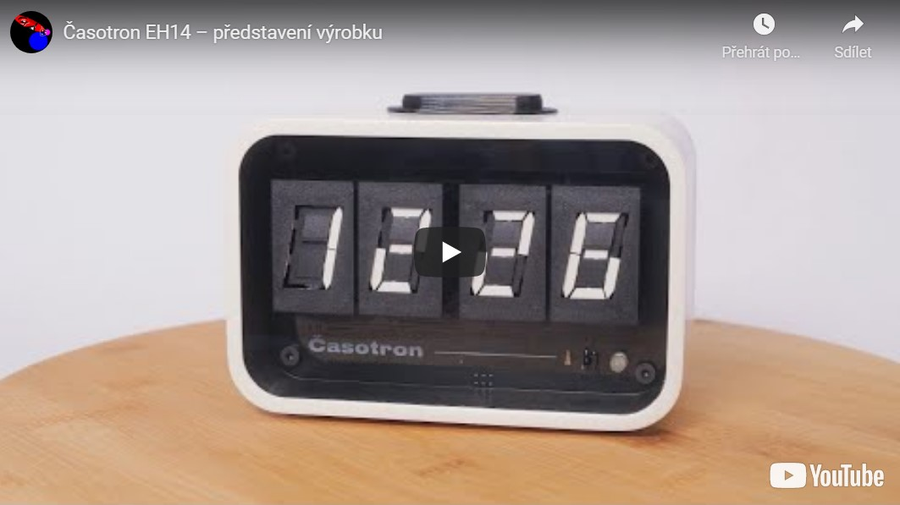

# Časotron EH14

Časotron EH14 is a digital clock, featuring mechanical displays and voice.

It is currently not for sale; there was only a limited run several years ago.

## Video (in Czech)

## Firmware

- `firmware/eh14` - the main board's firmware
- `firmware/eh14_ir_reciever` - the ATtiny85 receiver IC on the main board
- `firmware/eh14_ir_remote_control` - the ATtiny85 remote control
- `firmware/legacy` - the old firmwares

After cloning: `git submodule update --init --recursive`.

## License

**Code:**  
MIT

**Schematics:**  
CC BY-SA 4.0

**The original audio samples:**  
© 2020 Václav Knop. All rights reserved.  
Not part of this repository.